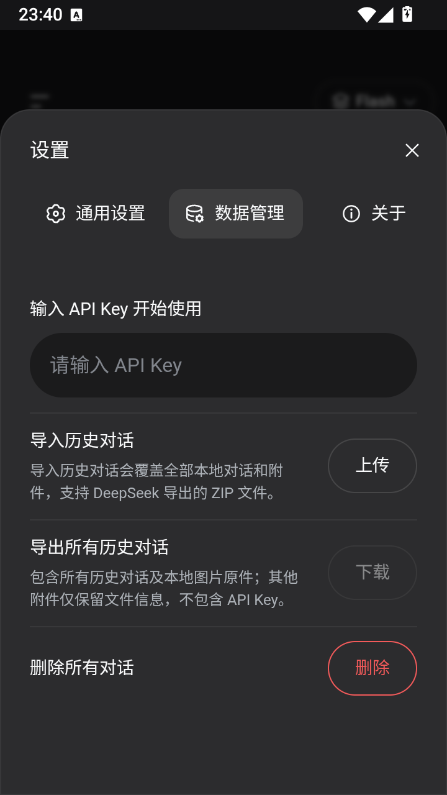
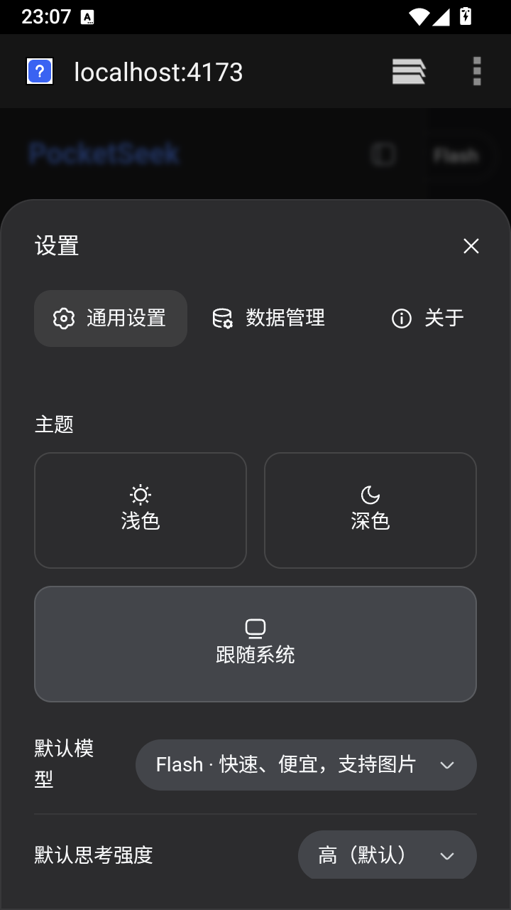
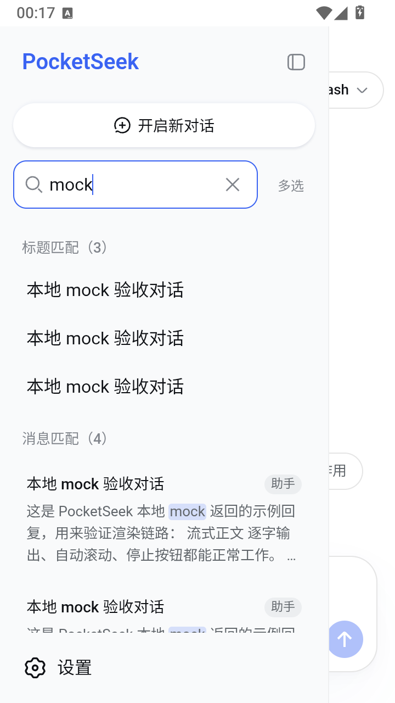
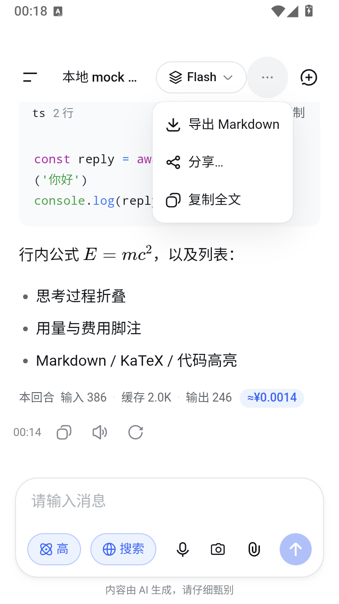
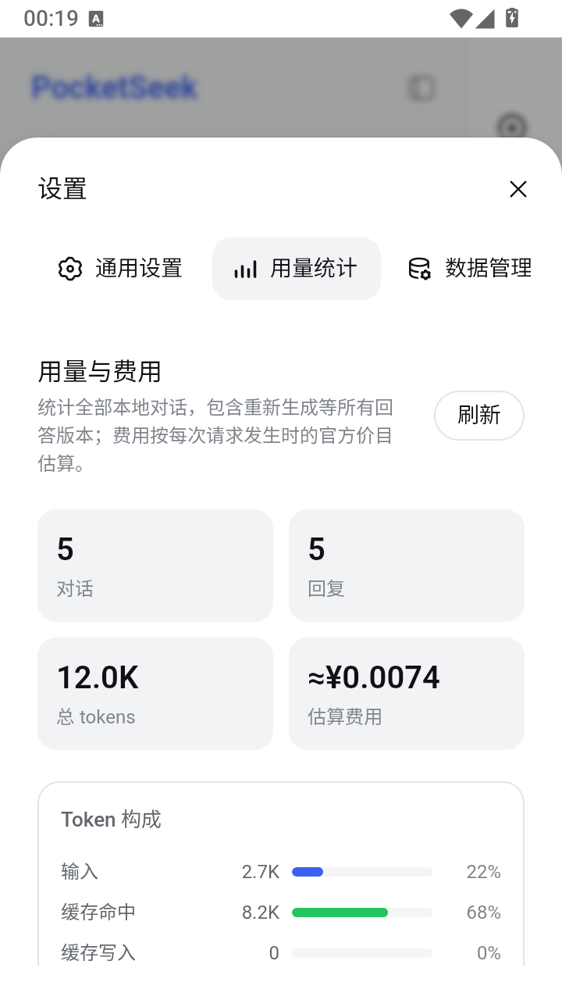
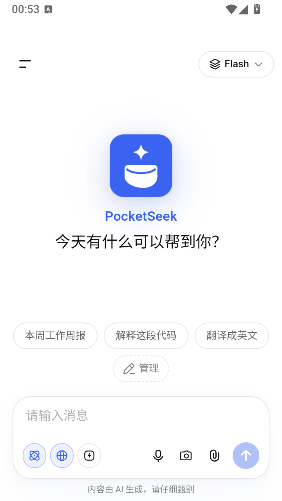
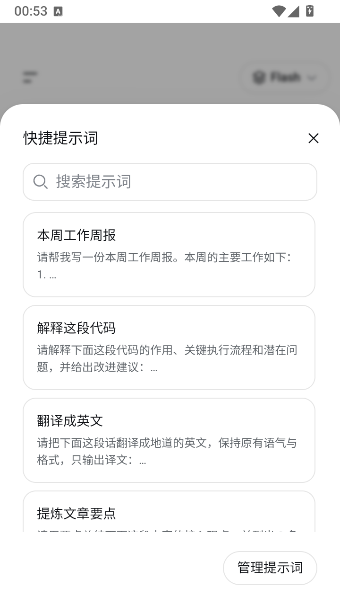
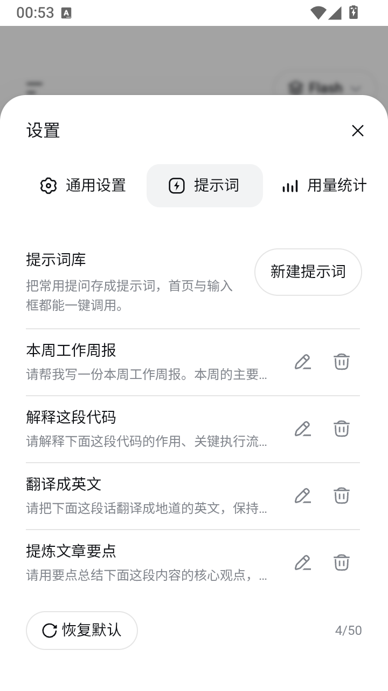
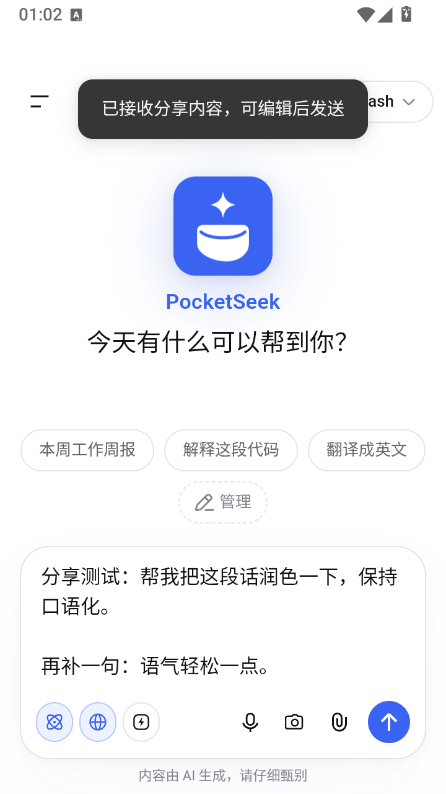
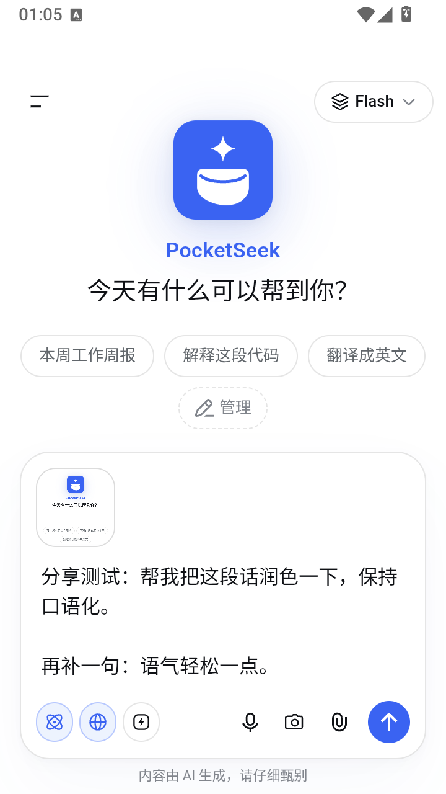

# PocketSeek


**口袋里的 AI 助手。** 品牌标记由「口袋 + 星芒」构成：把 AI 装进口袋，随时发问、随时探索。

**基于 DeepSeek 官方开源项目 [chat-demo](https://github.com/deepseek-ai/chat-demo)（MIT）改造的手机端第三方 DeepSeek API 客户端。**

> PocketSeek 与 DeepSeek（深度求索公司）没有任何隶属、合作、授权或官方认证关系，不是官方客户端。
> 不使用 DeepSeek 商标与 LOGO。API Key 由使用者自行提供，只保存在你自己的浏览器里。

| 启动页 | 浅色空态（品牌头像 + 快捷提问） | 深色空态 |
| --- | --- | --- |
|  |  |  |

| 对话（时间戳 / 代码工具条 / 回底浮钮） | 用量与费用脚注 | 设置 |
| --- | --- | --- |
|  |  |  |

| 全库搜索（标题 + 消息正文） | 会话操作（导出 / 分享 / 复制） | 用量统计 |
| --- | --- | --- |
|  |  |  |

| 快捷提问（读取词库） | 输入框快捷提示词 | 提示词库管理 |
| --- | --- | --- |
|  |  |  |

| 从系统分享文本（运行中） | 分享图片进入草稿 |
| --- | --- |
|  |  |

> 截图来自 Android 14 雷电模拟器（720×1280）。对话与搜索/统计截图使用本地 mock 数据联调，不是真实对话。

---

## 更新日志

### 0.6.2 — 中危审计修复

- **分享**：原生分享文本/待处理队列限额，图片改为逐张跨桥；PWA 分享目标改 POST multipart；导入历史期间的分享先暂存
- **网络**：Key 校验/上传/转写/流式建连增加超时；SSE 与错误响应体大小上限；SW 只缓存成功响应；本地静态服务器路径与异常处理加固
- **数据**：删除会话/清空历史后台清理远端 Files API 文件；多标签补发 Web Locks 串行化，会话 revision 防止旧快照覆盖；ZIP 归档保留用量与 latestReminder；IndexedDB 连接恢复
- **持久化**：流式回答每 2 秒落盘；取消排队消息不再覆盖新草稿
- **无障碍与性能**：Modal/菜单/下拉/移动面板焦点与键盘导航；图片附件懒加载；触摸滚动缓存祖先链；KaTeX 失败回退原文；安全区变量统一
- **质量**：开启 `react/rules-of-hooks`，新增 9 个 Node 测试并接入 CI；release 构建必须提供签名口令环境变量
- 详细审计报告：[docs/audit-2026-11-22.md](docs/audit-2026-11-22.md)

### 0.6.1 — 安全审计修复

- **渲染链**：升级 Mermaid / KaTeX 并锁定依赖，`pnpm audit --prod` 清零；Mermaid 渲染前剥离指令与 frontmatter；生产构建加入 CSP 与 `Referrer-Policy`
- **API Key**：原生壳改用 Android Keystore 加密存储（AES/GCM），旧 Key 启动时自动迁移并删除明文；备份排除密钥与 WebView Local Storage
- **导入导出**：ZIP 导入限制单条目 64MB / 总量 512MB / 1 万条目；导出包含全部本地附件原件，导入后文档附件可继续使用
- **持久化**：发送失败可恢复草稿文字；附件改为独立事务，配额不足不再阻塞文字保存；单消息附件总量上限 128MB
- **无障碍**：会话列表支持键盘 Enter/Space 切换、焦点样式与 `aria-current`
- 详细审计报告：[docs/audit-2026-11-22.md](docs/audit-2026-11-22.md)

### 0.6.0 — 离线发件箱

**断网也能先发出去**
- 离线时点击发送：消息立即进入本机发件箱，文字与已上传完成的附件一起保存在会话里，输入框顶部提示当前离线
- 恢复联网（`online` 事件）或重新打开 App 时按时间顺序自动补发；补发后沿用正常的思考、流式输出与标题生成
- 请求还没收到任何响应就断网时自动回到队列；已经收到流式内容的失败不自动重发，避免重复计费
- 待发送消息下方显示离线 / 网络异常状态，提供「立即发送」与「取消发送」；取消后消息撤回，内容与附件放回输入框，新会话的首条消息取消后回到首页
- 队列保存在 localStorage，刷新、杀进程重开都不丢；删除会话、导入历史或清空全部对话时同步清理
- 待发送期间阻止该会话的编辑、重答、切换版本与继续发送，避免分支与请求上下文错位
- 断网时无法新上传附件；已上传完成的附件可随暂存消息一起补发

### 0.5.0 — 从系统分享进来

**系统分享接入**
- Android 分享菜单新增 PocketSeek：其他 App 里的文本、单张或多张图片可直接分享进来
- 分享文本进入当前会话（或新对话）输入框，可编辑后再发送；冷启动与 App 运行中都能接收
- 分享图片自动加入草稿附件（最多 6 张，单张上限 12MB），复用现有压缩、上传与 Pro 模型图片拦截规则
- 未设置 API Key 时保留文字并引导设置；读取失败、格式不支持或超限的图片会提示跳过数量
- PWA 新增 Web Share Target：安装到桌面后可从系统分享文本/链接，默认进入新对话草稿；使用 POST multipart，分享内容不进入页面 URL

### 0.4.0 — 快捷提示词库

**提示词库**
- 设置新增「提示词」分组：可新建、编辑、删除提示词，最多保存 50 条
- 内置周报、代码解释、翻译、文章总结 4 条提示词；支持一键恢复默认
- 首页快捷提问改为读取词库前 3 条，点一下直接发送；旁边新增「管理」入口
- 输入框新增「提示词」入口：面板内可搜索，点选后按光标位置插入，未聚焦时追加到草稿末尾
- 修复窄屏（320dp）下输入区开关与右侧按钮重叠：移动端紧凑尺寸现在真正生效，提示词在空间不足时收为图标
- 提示词只保存在本机 localStorage，不随历史对话 ZIP 导出

### 0.3.1 — 关于页版本号可读性修复

- 修复关于页「版本 x.y.z」使用过浅的次要色，在浅色与深色主题下都难以辨认的问题
- 版本号改为更高对比度的次级文字色并略增字号，深浅主题下均清晰可读

### 0.3.0 — 品牌图标与首页头像

**全新品牌标记**
- App 图标从问号占位升级为「口袋 + 星芒」：品牌蓝圆角底、白色口袋、蓝色开口、口袋上方 AI 星芒
- 重新生成 PWA 图标（含 maskable）、favicon、Apple touch icon、Android 普通 / 圆形 / 自适应 / 单色主题图标与全部启动图
- 首页新增品牌头像与 PocketSeek 品牌名，侧边栏、关于页统一使用新标记；移除旧的线条问号空态
- 修复手动切到深色主题时 Android 状态栏 / 手势栏底色仍为白色的问题：原生窗口底色跟随网页主题同步

### 0.2.0 — 全库搜索 / 导出分享 / 用量统计

**全库搜索**
- 侧边栏搜索升级为跨会话搜索：同时匹配会话标题与当前分支的消息正文，结果带关键词高亮与上下文摘要
- 点击消息结果直接打开对应会话，滚动到该消息并短暂高亮定位
- 搜索防抖、结果有上限；命中过多时提示缩小关键词；摘要自动去掉 Markdown 标记

**导出与分享**
- 会话顶栏新增「⋯」菜单：导出 Markdown / 系统分享 / 复制全文
- 导出保留当前分支的问题、回答、附件名与引用来源链接；不包含思考过程与 API Key
- 浏览器里直接下载 `.md`；Android 壳内先写入缓存文件，再调起系统分享面板保存或发送
- 修复 Windows 下 `pnpm build` 因 `NODE_ENV=` 前缀不可用的问题，改为跨平台的 `scripts/build.mjs`

**用量统计**
- 设置新增「用量统计」：对话数、回复数、总 tokens、估算费用
- Token 构成（输入 / 缓存命中 / 缓存写入 / 输出）与占比条
- 近 7 天用量柱状图，按模型（Flash / Pro）拆分
- 覆盖全部本地会话与所有回答版本（含重新生成）；按每次请求发生时段逐条估算

### 0.1.2 — 消息区 / 输入区 / 会话管理 / 可读性 / 品牌细节

**消息区**
- 每条消息显示时间戳：当天 `HH:MM`，跨天 `M月D日 HH:MM`
- 长按（桌面端右键）消息弹出菜单：复制 / 引用（以 Markdown 引用块插入输入框）/ 重新生成；用户消息可编辑
- 上滚离开底部时出现「回到底部」浮钮，点击平滑回底并恢复跟随
- 代码块工具条：语言名 + 行数 + 折叠/展开（≥12 行）+ 复制；折叠时只保留前 12 行并给渐变提示

**输入区**
- 文字草稿持久化到 localStorage：刷新或重开页面后自动恢复，并提示一次
- 图片附件点击全屏预览（点遮罩 / Esc / 关闭按钮退出）
- 语音输入改为滚动振幅波形，支持暂停/继续（暂停不计时，结束前自动恢复采集保证音频完整）
- 发送成功后按钮短暂变为对勾（600ms），草稿与 localStorage 同步清空

**会话管理**
- 侧边栏搜索：按标题过滤，含清除按钮与空态
- 置顶会话单独成组（图钉标识、可取消置顶）
- 多选批量删除：勾选 + 底部工具条 + 二次确认
- 日期分组可折叠，折叠状态本地持久化

**可读性**
- 设置 → 阅读体验：正文字号（小/标准/大）、行距（紧凑/标准/宽松）、消息宽度（紧凑/标准/宽屏）
- 选中文本使用品牌蓝淡底高亮

**品牌细节**
- 启动页：原生 splash 停留 250ms + 200ms 淡出，Web 首帧 200ms 淡入
- 图标微调（问号比例与圆角），图标与启动图全尺寸重新生成
- 空态线条插画（口袋 + 问号，单色描边，无彩色装饰）

### 0.1.1 — UI/UX 打磨

- **用量脚注更清晰**：改为「本回合 · 输入 / 缓存命中 / 输出」，费用用品牌色胶囊突出，不再是浅灰小字。
- **触屏操作可达**：`@media (hover: none)` 下消息操作（复制 / 朗读 / 重新生成）常显，此前历史消息在手机上无法操作。
- **空态快捷提问**：欢迎页三个一键开聊的提示胶囊，点一下直接发送。
- **模型胶囊加下拉指示**：明确这是可点开的选择器，展开时箭头旋转。
- **原生状态栏/系统栏跟随主题**：浅色主题白底深图标、深色主题深底浅图标；Android 安全区改用 Capacitor 注入的 `--safe-area-inset-*`（WebView 不认 `env()`）。
- **关于页安装状态**：APK 内显示「已安装在当前设备」，不再显示不可点击的安装按钮。
- 修复：XML 注释里的 `--` 导致资源编译失败；`@capacitor/core` 归位到运行时依赖。

---

## 功能

在官方 chat-demo 全部能力之上，针对手机做了改造与新增：

- **对话**：流式输出、深度思考折叠（回答开始后自动收起，可手动展开）、停止 / 重新生成 / 继续生成、消息分支、编辑提问、时间戳、长按菜单（复制 / 引用 / 重新生成）、回到底部浮钮、代码块折叠与复制
- **模型切换**：顶栏胶囊一键切换 `deepseek-flash`（快、便宜、支持图片）与 `deepseek-v4-pro`（推理更强、不支持图片，选 Pro 时上传图片会被拦下并提示）
- **思考档位**：关闭 / 低 / 高（默认）/ 极高，对应官方 `reasoning.effort`
- **联网搜索与读链接**：智能搜索开关、来源引用、搜索结果面板
- **附件与拍照**：相册/文件/拖拽/粘贴，移动端相机直拍（`capture=environment`），图片压缩后经 Files API 上传；草稿图片可全屏预览
- **快捷提示词**：提示词库可新建 / 编辑 / 删除 / 恢复默认；首页快捷提问与输入框「提示词」面板共用同一份词库，支持搜索与按光标插入
- **分享接入**：从其他 App 直接分享文本、单张或多张图片进来，进入当前会话草稿；PWA 安装后支持分享文本与链接
- **离线发件箱**：断网时发送的消息暂存在本机，联网或重启 App 后自动补发；待发送消息可立即重试或取消，取消后文字与已上传附件回到输入框
- **输入体验**：文字草稿自动恢复、语音输入滚动波形与暂停、发送成功对勾反馈
- **会话管理**：全库搜索（标题与消息正文、命中高亮、点击跳转到消息）、置顶、多选批量删除、日期分组折叠
- **导出与分享**：单会话导出 Markdown（保留正文、附件名与引用链接）、复制全文、调用系统分享；Android 通过系统面板保存文件
- **阅读体验**：正文字号 / 行距 / 消息宽度可调，选中文本品牌色高亮
- **用量与费用**：每条回复下方显示「本回合」的输入 / 缓存命中 / 输出 tokens 与按官方价目估算的人民币费用（品牌色胶囊突出，可在设置中关闭）；设置 → 用量统计汇总全部会话的总量、近 7 天趋势与按模型拆分
- **渲染**：Markdown、代码高亮、KaTeX 公式、Mermaid 图表
- **本地优先**：会话/附件存 IndexedDB，API Key 在原生壳内使用 Android Keystore 加密存储（浏览器版存 localStorage）；支持 ZIP 历史导入导出（兼容 DeepSeek 官方导出格式，含本地附件原件）
- **品牌**：口袋 + 星芒应用图标，首页品牌头像、侧边栏与关于页统一标识；PWA / favicon / Android 自适应与单色图标 / 启动图同步更新
- **手机端**：单栏会话 + 抽屉会话列表、安全区适配（含 Android 原生壳）、键盘弹起适配、深色主题跟随系统并同步系统栏图标与窗口底色、空态品牌头像与快捷提问、触屏常显操作按钮、中文单语
- **PWA**：manifest / 图标 / Service Worker 离线壳 / 安装引导（需要 HTTPS 或 localhost 才生效）

## 快速开始（Windows）

需要 Node.js 22.12+ 与 pnpm。

```sh
pnpm install
pnpm build
pnpm serve        # 默认 http://0.0.0.0:4173
```

也可以直接双击 `start.bat`（自动装依赖 → 构建 → 起服务）。

打开后：

1. 首次启动会自动打开设置 → **数据管理** → 填入你的 DeepSeek API Key（在 [platform.deepseek.com](https://platform.deepseek.com) 申请），回车校验。
2. 回到对话页开始使用。

### 在手机上用

**方式一（推荐）：装 APK**

已构建并签名的安装包：[`release/PocketSeek-0.6.2.apk`](release/PocketSeek-0.6.2.apk)（约 5.2MB，Android 7.0+，sha256 见 `release/PocketSeek-0.6.2.apk.sha256`）

1. 把 APK 传到手机（微信文件传输 / 数据线 / 网盘均可）。
2. 点击安装；系统提示「未知来源」时允许该来源。
3. 打开 PocketSeek → 设置 → 数据管理 → 填入 DeepSeek API Key。
4. 之后无需电脑、无需浏览器，像普通 App 一样使用。

包名 `com.pocketseek.app`，版本 `0.6.2`，targetSdk 36 / minSdk 24，自签证书（`CN=PocketSeek`）。从 0.5.x/0.6.x 覆盖安装即可，本地数据与 API Key 保留。
重新构建见 [docs/android-build.md](docs/android-build.md)：Capacitor 8 + JDK 21 + 自建 Android SDK，全部走国内镜像，无需 Android Studio。

**方式二：手机浏览器**

1. 电脑与手机连同一个 Wi-Fi，执行 `pnpm serve`，记下终端打印的 `手机（同一 Wi-Fi）：http://192.168.x.x:4173`
2. 手机浏览器打开该地址即可（Android Chrome / 系统浏览器均可）。
3. 想装到桌面：把 `dist/` 部署到任意 HTTPS 静态站（如 GitHub Pages），再在浏览器菜单里「添加到主屏幕」。

> 局域网 http 不是安全上下文，Service Worker 不会注册，所以局域网访问时没有离线壳、也没有一键安装按钮；功能本身不受影响。

## 开发

```sh
pnpm dev          # 开发服务器 http://localhost:8090
pnpm type         # TypeScript 类型检查
pnpm lint         # oxlint
pnpm test         # Node 内置测试（SSE / URL / ZIP）
pnpm build        # 生产构建到 dist/
```

### 本地 mock 联调（不消耗真实额度）

`scripts/mock-api.mjs` 实现了 Anthropic 兼容的最小流式接口（含思考块、正文、usage、标题），可以用它验收 UI 与流式渲染：

```sh
node scripts/mock-api.mjs                                             # 127.0.0.1:4174
POCKETSEEK_API_ORIGIN=http://127.0.0.1:4174 pnpm build                # Git Bash；PowerShell 用 $env:POCKETSEEK_API_ORIGIN="http://127.0.0.1:4174"; pnpm build
pnpm serve
# 验收结束后务必重新执行 pnpm build，恢复默认的 https://api.deepseek.com
```

## 数据与隐私

- API Key 只保存在本机浏览器 `localStorage`（键前缀 `pocketseek:`），不会发往除 DeepSeek API 之外的任何服务器。
- 会话与附件原件保存在本机 IndexedDB（库名 `pocketseek`）。
- 从系统分享进入的文字与图片只写入本机草稿，不会自动发送；只有你点发送后才提交给 API。
- 离线待发送消息与队列只保存在本机（会话在 IndexedDB，队列表在 localStorage）；恢复联网补发时才会提交给你配置的 API。
- 发送消息、上传附件、语音功能会把对应内容提交给你配置的 API 服务（默认 `https://api.deepseek.com`）。
- 导出的 ZIP 不包含 API Key；格式与官方 chat-demo 的导出兼容。
- 单会话导出的 Markdown 与系统分享内容会包含对话正文、附件文件名和引用链接，请自行确认分享范围；不包含 API Key、思考过程与附件原件。

## 与原项目的差异

保留：MIT 许可证与版权声明（见 `LICENSE`）、多会话、分支/重答、思考、搜索引用、读链接、附件、语音输入与朗读、KaTeX/Mermaid、导入导出、深浅主题。

改动：品牌与图标（PocketSeek 口袋 + 星芒标记、首页品牌头像、PWA/Android 全套图标与启动图）、中文单语（删除英文词典与语言/位置设置）、手机端信息架构与安全区、模型切换、思考档位、相机直拍、用量/费用脚注、PWA（manifest/SW/安装引导）、原生窗口底色跟随主题、系统提示词改为第三方身份说明、存储键与 IndexedDB 全部改名、导出文件名改为 `pocketseek_data-YYYY-MM-DD.zip`（ZIP 内部结构与格式版本不变，仍可导入官方导出文件）；新增全库搜索、单会话 Markdown 导出/系统分享、用量统计、可管理的快捷提示词库与系统分享接入。

## 已知限制

- **Pro 不支持图片**：上传图片会被拦截并提示切回 Flash。
- **费用是估算**：用量脚注与统计页都按官方价目和请求发生时段（高峰/闲时）估算，未计入联网搜索等额外计费，实际以账单为准。
- **用量统计覆盖所有回答版本**：重新生成、未选中的分支也真实消耗额度，因此统计值可能高于当前可见对话；统计在打开时即时计算，会话变化后点「刷新」。
- **导出不含思考过程**：Markdown 只保留问题、回答、附件名与引用链接，不包含附件原件；附件原件仍需使用 ZIP 全量导出。
- **系统分享依赖目标 App**：手机上没有任何可接收分享的应用时，系统会提示「没有应用可执行此操作」；可改用「复制全文」。
- **离线补发依赖系统联网状态**：自动补发在系统报告恢复联网或重新打开 App 时触发；若系统显示在线但网络实际不通，可在待发送消息下方点「立即发送」重试。
- **离线队列逐条补发**：同一会话同时只保留一条待发送消息，全部队列按时间顺序串行补发；待发送期间该会话不能继续发送、编辑或重新生成。
- **所有数据仅本机**：没有账号体系与跨设备同步；换浏览器/清缓存会丢历史（可先导出 ZIP）。
- **提示词不随 ZIP 导出**：提示词库保存在 localStorage，历史对话导出只包含会话与附件；换设备后需要重新添加或恢复默认。
- **分享图片有上限**：系统分享一次最多带入 6 张图片、单张不超过 12MB，超出部分会跳过；PWA 的 Web Share Target 只接收文本与链接，不接收图片。
- **PWA 安装需要 HTTPS**：局域网 http 只能当普通网页用。
- **未内置任何 Key / 代理**：BYO-Key（用户自带 Key）模式。

## 路线图

- ✅ **Android APK**：Capacitor 8 原生壳已出包（见上），自签、可直接侧载。
- ✅ **品牌形象**：0.3.0 完成口袋 + 星芒图标、首页品牌头像、PWA/Android 全套图标与启动图。
- ✅ **会话回顾与带走**：0.2.0 已支持全库搜索、Markdown 导出、系统分享与用量统计。
- ✅ **快捷输入**：0.4.0 完成可管理的提示词库，首页与输入框共用。
- ✅ **接收分享**：0.5.0 完成从系统分享文本/图片进入草稿（Android 壳 + PWA 文本/链接）。
- ✅ **离线发件箱**：0.6.0 完成断网暂存、联网自动补发，以及立即重试与取消还原。
- ✅ **安全加固**：0.6.1 完成 7 项高危修复；0.6.2 完成全部中危审计项（分享/网络/数据/持久化/无障碍/测试）。
- ⏳ **公网 HTTPS**：仓库带 `.github/workflows/pages.yml`，推到 GitHub 开启 Pages 即可获得可安装的 PWA。
- ⏳ 正式上架应用商店：需要换正式发布密钥（当前为自签）、补隐私政策与年龄分级。

## 许可证与署名

- 本项目基于 [deepseek-ai/chat-demo](https://github.com/deepseek-ai/chat-demo)，遵循 MIT，原始版权声明保留在 `LICENSE`。
- 改动与合规说明见 `NOTICE`。
