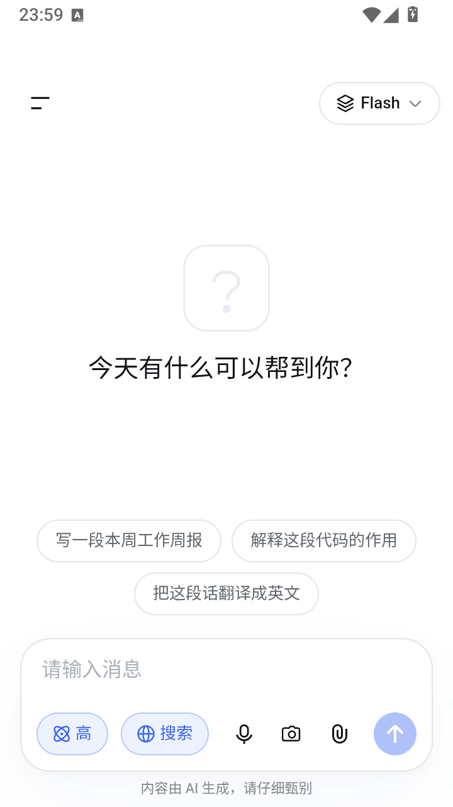
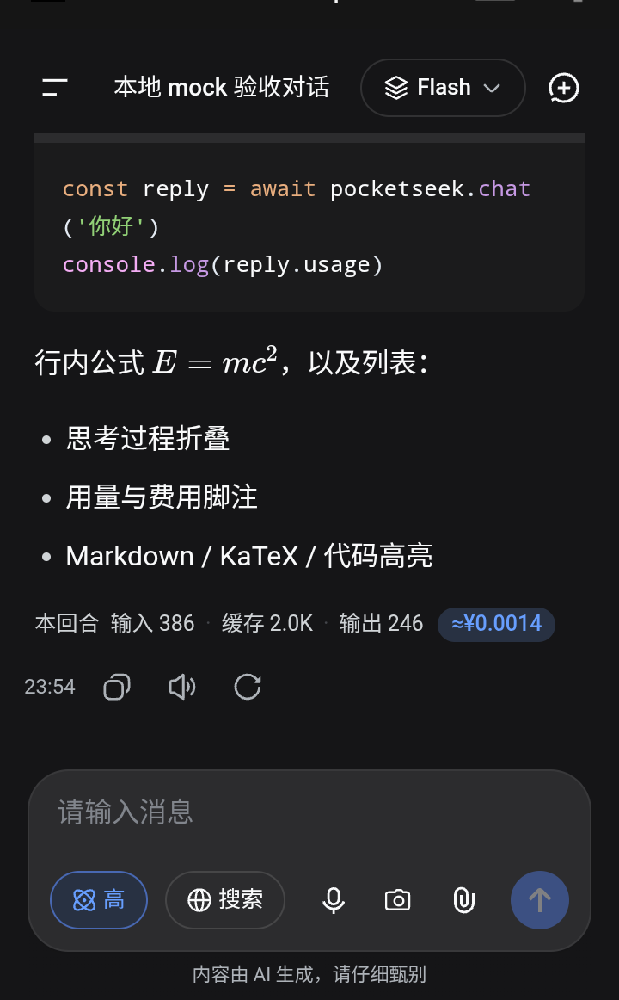
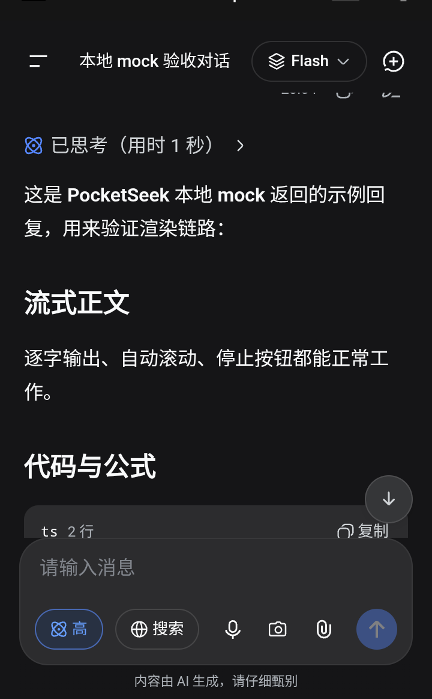

# PocketSeek

**基于 DeepSeek 官方开源项目 [chat-demo](https://github.com/deepseek-ai/chat-demo)（MIT）改造的手机端第三方 DeepSeek API 客户端。**

> PocketSeek 与 DeepSeek（深度求索公司）没有任何隶属、合作、授权或官方认证关系，不是官方客户端。
> 不使用 DeepSeek 商标与 LOGO。API Key 由使用者自行提供，只保存在你自己的浏览器里。

| 启动页 | 浅色空态（线条插画 + 快捷提问） | 深色空态 |
| --- | --- | --- |
|  |  |  |

| 对话（时间戳 / 代码工具条 / 回底浮钮） | 用量与费用脚注 | 设置 |
| --- | --- | --- |
|  |  |  |

> 截图来自 Android 14 雷电模拟器（720×1280）。对话截图使用本地 mock 数据联调，不是真实对话。

---

## 更新日志

### 0.1.2 — 消息区 / 输入区 / 会话管理 / 可读性 / 品牌细节

**消息区**
- 每条消息显示时间戳：当天 `HH:MM`，跨天 `M月D日 HH:MM`
- 长按（桌面端右键）消息弹出菜单：复制 / 引用（以 Markdown 引用块插入输入框）/ 重新生成；用户消息可编辑
- 上滚离开底部时出现「回到底部」浮钮，点击平滑回底并恢复跟随
- 代码块工具条：语言名 + 行数 + 折叠/展开（≥12 行）+ 复制；折叠时只保留前 12 行并给渐变提示

**输入区**
- 文字草稿持久化到 localStorage：刷新或重开页面后自动恢复，并提示一次
- 图片附件点击全屏预览（点遮罩 / Esc / 关闭按钮退出）
- 语音输入改为滚动振幅波形，支持暂停/继续（暂停不计时，结束前自动恢复采集保证音频完整）
- 发送成功后按钮短暂变为对勾（600ms），草稿与 localStorage 同步清空

**会话管理**
- 侧边栏搜索：按标题过滤，含清除按钮与空态
- 置顶会话单独成组（图钉标识、可取消置顶）
- 多选批量删除：勾选 + 底部工具条 + 二次确认
- 日期分组可折叠，折叠状态本地持久化

**可读性**
- 设置 → 阅读体验：正文字号（小/标准/大）、行距（紧凑/标准/宽松）、消息宽度（紧凑/标准/宽屏）
- 选中文本使用品牌蓝淡底高亮

**品牌细节**
- 启动页：原生 splash 停留 250ms + 200ms 淡出，Web 首帧 200ms 淡入
- 图标微调（问号比例与圆角），图标与启动图全尺寸重新生成
- 空态线条插画（口袋 + 问号，单色描边，无彩色装饰）

### 0.1.1 — UI/UX 打磨

- **用量脚注更清晰**：改为「本回合 · 输入 / 缓存命中 / 输出」，费用用品牌色胶囊突出，不再是浅灰小字。
- **触屏操作可达**：`@media (hover: none)` 下消息操作（复制 / 朗读 / 重新生成）常显，此前历史消息在手机上无法操作。
- **空态快捷提问**：欢迎页三个一键开聊的提示胶囊，点一下直接发送。
- **模型胶囊加下拉指示**：明确这是可点开的选择器，展开时箭头旋转。
- **原生状态栏/系统栏跟随主题**：浅色主题白底深图标、深色主题深底浅图标；Android 安全区改用 Capacitor 注入的 `--safe-area-inset-*`（WebView 不认 `env()`）。
- **关于页安装状态**：APK 内显示「已安装在当前设备」，不再显示不可点击的安装按钮。
- 修复：XML 注释里的 `--` 导致资源编译失败；`@capacitor/core` 归位到运行时依赖。

---

## 功能

在官方 chat-demo 全部能力之上，针对手机做了改造与新增：

- **对话**：流式输出、深度思考折叠（回答开始后自动收起，可手动展开）、停止 / 重新生成 / 继续生成、消息分支、编辑提问、时间戳、长按菜单（复制 / 引用 / 重新生成）、回到底部浮钮、代码块折叠与复制
- **模型切换**：顶栏胶囊一键切换 `deepseek-flash`（快、便宜、支持图片）与 `deepseek-v4-pro`（推理更强、不支持图片，选 Pro 时上传图片会被拦下并提示）
- **思考档位**：关闭 / 低 / 高（默认）/ 极高，对应官方 `reasoning.effort`
- **联网搜索与读链接**：智能搜索开关、来源引用、搜索结果面板
- **附件与拍照**：相册/文件/拖拽/粘贴，移动端相机直拍（`capture=environment`），图片压缩后经 Files API 上传；草稿图片可全屏预览
- **输入体验**：文字草稿自动恢复、语音输入滚动波形与暂停、发送成功对勾反馈
- **会话管理**：搜索、置顶、多选批量删除、日期分组折叠
- **阅读体验**：正文字号 / 行距 / 消息宽度可调，选中文本品牌色高亮
- **用量与费用**：每条回复下方显示「本回合」的输入 / 缓存命中 / 输出 tokens 与按官方价目估算的人民币费用（品牌色胶囊突出，可在设置中关闭）
- **渲染**：Markdown、代码高亮、KaTeX 公式、Mermaid 图表
- **本地优先**：会话/附件存 IndexedDB，API Key 与设置存 localStorage；支持 ZIP 历史导入导出（兼容 DeepSeek 官方导出格式）
- **手机端**：单栏会话 + 抽屉会话列表、安全区适配（含 Android 原生壳）、键盘弹起适配、深色主题跟随系统并同步系统栏图标、空态快捷提问与线条插画、触屏常显操作按钮、中文单语
- **PWA**：manifest / 图标 / Service Worker 离线壳 / 安装引导（需要 HTTPS 或 localhost 才生效）

## 快速开始（Windows）

需要 Node.js 22.12+ 与 pnpm。

```sh
pnpm install
pnpm build
pnpm serve        # 默认 http://0.0.0.0:4173
```

也可以直接双击 `start.bat`（自动装依赖 → 构建 → 起服务）。

打开后：

1. 首次启动会自动打开设置 → **数据管理** → 填入你的 DeepSeek API Key（在 [platform.deepseek.com](https://platform.deepseek.com) 申请），回车校验。
2. 回到对话页开始使用。

### 在手机上用

**方式一（推荐）：装 APK**

已构建并签名的安装包：[`release/PocketSeek-0.1.2.apk`](release/PocketSeek-0.1.2.apk)（约 5.1MB，Android 7.0+，sha256 见 `release/PocketSeek-0.1.2.apk.sha256`）

1. 把 APK 传到手机（微信文件传输 / 数据线 / 网盘均可）。
2. 点击安装；系统提示「未知来源」时允许该来源。
3. 打开 PocketSeek → 设置 → 数据管理 → 填入 DeepSeek API Key。
4. 之后无需电脑、无需浏览器，像普通 App 一样使用。

包名 `com.pocketseek.app`，版本 `0.1.2`，targetSdk 36 / minSdk 24，自签证书（`CN=PocketSeek`）。
重新构建见 [docs/android-build.md](docs/android-build.md)：Capacitor 8 + JDK 21 + 自建 Android SDK，全部走国内镜像，无需 Android Studio。

**方式二：手机浏览器**

1. 电脑与手机连同一个 Wi-Fi，执行 `pnpm serve`，记下终端打印的 `手机（同一 Wi-Fi）：http://192.168.x.x:4173`
2. 手机浏览器打开该地址即可（Android Chrome / 系统浏览器均可）。
3. 想装到桌面：把 `dist/` 部署到任意 HTTPS 静态站（如 GitHub Pages），再在浏览器菜单里「添加到主屏幕」。

> 局域网 http 不是安全上下文，Service Worker 不会注册，所以局域网访问时没有离线壳、也没有一键安装按钮；功能本身不受影响。

## 开发

```sh
pnpm dev          # 开发服务器 http://localhost:8090
pnpm type         # TypeScript 类型检查
pnpm lint         # oxlint
pnpm build        # 生产构建到 dist/
```

### 本地 mock 联调（不消耗真实额度）

`scripts/mock-api.mjs` 实现了 Anthropic 兼容的最小流式接口（含思考块、正文、usage、标题），可以用它验收 UI 与流式渲染：

```sh
node scripts/mock-api.mjs                                             # 127.0.0.1:4174
POCKETSEEK_API_ORIGIN=http://127.0.0.1:4174 pnpm build                # 构建指向 mock 的联调版
pnpm serve
# 验收结束后务必重新执行 pnpm build，恢复默认的 https://api.deepseek.com
```

## 数据与隐私

- API Key 只保存在本机浏览器 `localStorage`（键前缀 `pocketseek:`），不会发往除 DeepSeek API 之外的任何服务器。
- 会话与附件原件保存在本机 IndexedDB（库名 `pocketseek`）。
- 发送消息、上传附件、语音功能会把对应内容提交给你配置的 API 服务（默认 `https://api.deepseek.com`）。
- 导出的 ZIP 不包含 API Key；格式与官方 chat-demo 的导出兼容。

## 与原项目的差异

保留：MIT 许可证与版权声明（见 `LICENSE`）、多会话、分支/重答、思考、搜索引用、读链接、附件、语音输入与朗读、KaTeX/Mermaid、导入导出、深浅主题。

改动：品牌与图标（PocketSeek）、中文单语（删除英文词典与语言/位置设置）、手机端信息架构与安全区、模型切换、思考档位、相机直拍、用量/费用脚注、PWA（manifest/SW/安装引导）、系统提示词改为第三方身份说明、存储键与 IndexedDB 全部改名、导出文件名改为 `pocketseek_data-YYYY-MM-DD.zip`（ZIP 内部结构与格式版本不变，仍可导入官方导出文件）。

## 已知限制

- **Pro 不支持图片**：上传图片会被拦截并提示切回 Flash。
- **费用是估算**：按官方价目表与当前时段（高峰/闲时）计算，未计入服务端搜索等额外计费，实际以账单为准。
- **所有数据仅本机**：没有账号体系与跨设备同步；换浏览器/清缓存会丢历史（可先导出 ZIP）。
- **PWA 安装需要 HTTPS**：局域网 http 只能当普通网页用。
- **未内置任何 Key / 代理**：BYO-Key（用户自带 Key）模式。

## 路线图

- ✅ **Android APK**：Capacitor 8 原生壳已出包（见上），自签、可直接侧载。
- ⏳ **公网 HTTPS**：仓库带 `.github/workflows/pages.yml`，推到 GitHub 开启 Pages 即可获得可安装的 PWA。
- ⏳ 分享目标（从其他 App 直接分享文本/图片进来）、离线草稿队列。
- ⏳ 正式上架应用商店：需要换正式发布密钥（当前为自签）、补隐私政策与年龄分级。

## 许可证与署名

- 本项目基于 [deepseek-ai/chat-demo](https://github.com/deepseek-ai/chat-demo)，遵循 MIT，原始版权声明保留在 `LICENSE`。
- 改动与合规说明见 `NOTICE`。
